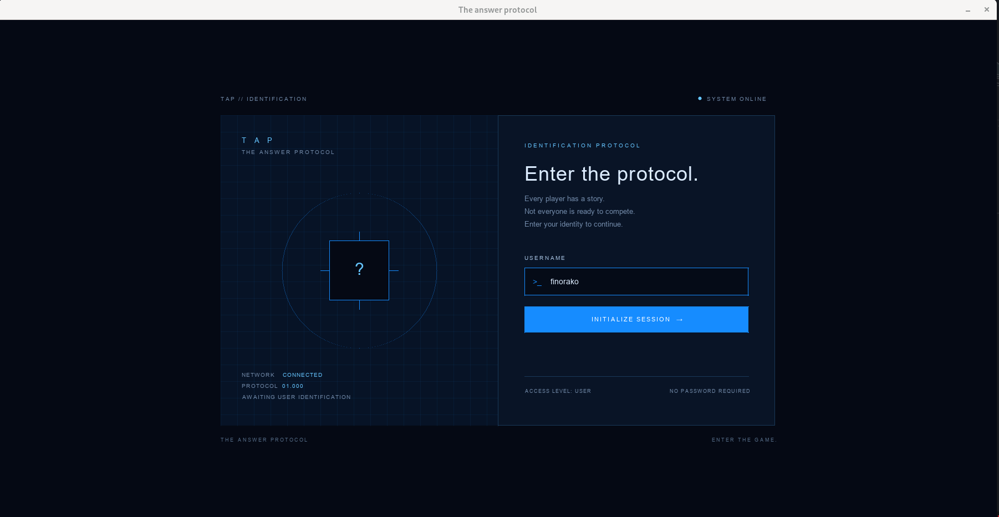
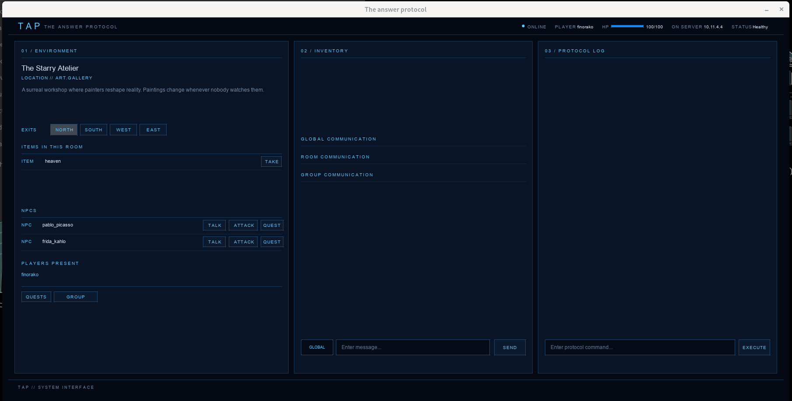
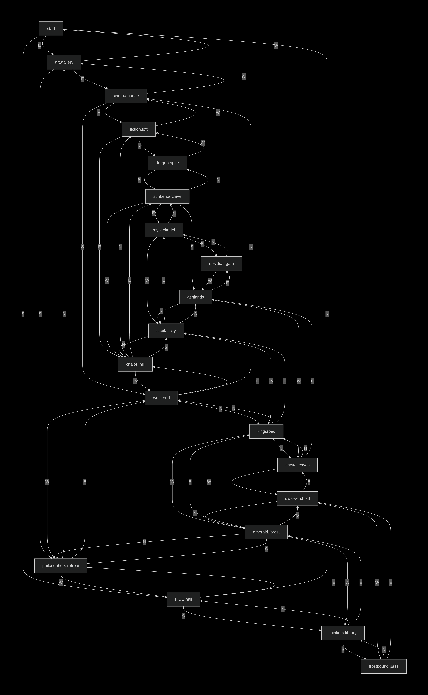

_This project has been created as part of the 42 curriculum by irraheri, mrazakam, finorako_

# Answer Protocol

<!--toc:start-->
- [Answer Protocol](#answer-protocol)
  - [Description](#description)
  - [Project Management](#project-management)
  - [Resources](#resources)
  - [Instructions](#instructions)
    - [Build and running the program](#build-and-running-the-program)
    - [Interacting with the program](#interacting-with-the-program)
      - [GUI](#gui)
      - [CLI](#cli)
  - [Architectures](#architectures)
    - [Dispatcher/Router vs Inline handling](#dispatcherrouter-vs-inline-handling)
    - [Concurrency model](#concurrency-model)
  - [Combat System](#combat-system)
  - [Quest System](#quest-system)
  - [Server logging](#server-logging)
    - [Log format](#log-format)
    - [Abuse pattern](#abuse-pattern)
  - [Building and Running](#building-and-running)
  - [Protocol Implementation](#protocol-implementation)
  - [Testing](#testing)
  - [Group Contributions](#group-contributions)
    - [Server](#server)
    - [GUI](#gui-1)
    - [World](#world)
  - [What need to be improvised](#what-need-to-be-improvised)
    - [Performance](#performance)
    - [Data Management](#data-management)
<!--toc:end-->

## Description

A text-based multiplayer game (often called a MUD or Multi-User Dungeon) is a
persistent online world described entirely through written text rather than
graphics, where players interact via typed commands or menu choices. These games
feature shared persistent servers where thousands of players coexist, creating a
live economy, player-run politics, and real-time social interactions that
continue to evolve even when individual players are offline.

## Project Management

This project has been created by 3 people: `irraheri`, `mrazakam` and `finorako`

| Login    | TASK                            |
| -------- | ------------------------------- |
| irraheri | the main concept of the server  |
| mrazakam | Rendering the gui of the client |
| finorako | the creation of the world       |

## Resources

- [SDL3](https://wiki.libsdl.org/SDL3/FrontPage)
- [Zeal](https://zealdocs.org)
- man command
- [Server Architectures](https://berb.github.io/diploma-thesis/original/042_serverarch.html)

## Instructions

### Build and running the program

- `make`: Build all the program
- `make run-server`: run the server
- `make run-client`: run the client cli
- `make run-client-cli`: run the client with a gui
- `make lint`: doing a static lint check

### Interacting with the program

You have two options to run the program (with the gui, or cli).

#### GUI

Here you need to enter the name you want to use in the world.


Now that you are logged in, It should be fairly intuitive how to use it.


#### CLI

First of all run `make run-client-cli`

Now that you lanched it, you have the set of command bellow:

| CMD                     | ACTION                                              |
| ----------------------- | --------------------------------------------------- |
| CONNECT username        | Connect the client to the server                    |
| QUIT                    | Disconnect from the server                          |
| TALK npc                | talk to the npc                                     |
| CHAT ROOM message       | chat in the current room you are in                 |
| CHAT GLOBAL message     | send message to all user                            |
| CHAT GROUP message      | send message to user in the same group as player    |
| GROUP CREATE group_name | creating a group                                    |
| GROUP JOIN group_name   | join group_name                                     |
| GROUP LEAVE group_name  | leave the group_name                                |
| QUEST npc               | request a quest from the npc                        |
| QUESTS                  | view current/done quests                            |
| COMPLETE_QUEST quest_id | request an appeal to verify if quest_id is finished |
| ATTACK npc              | attacking the npc                                   |
| MOVE direction          | move to the desired direction                       |

## Architectures

### Dispatcher/Router vs Inline handling

We think that for our implementation we should go with `dispatcher` as
the event is strictly dependent to our code and is easier to use in our
implementation. Where `inline handling` is dependant to an event.

### Concurrency model

There was a lot more way to do this project, but for ours we went with
multithreading as we already knew a little about it with the project
`codexion`.

For the cli client, we used `atomicint` as it don't need to be protected by mutex.

In the server, we didn't used `atomicint` but used a simple `mutex` to protect shared data.

## Combat System

As we said before, there are so many ways to improve this project,
and one of them is making the npc think. For now, our implementation
use an arbitrary value of attack and damage caused by npc and player.

The moment the player's life reach 0 they spawn in the first zone as it is
considered safe.

## Quest System

For the quest system, we for now only implemented `take` and `kill` but
later on, when we have time, we plan on adding new quest type.

As soon as a you finished the quest and request a `complete quest`
if the quest where to have a reward for example it will be instantly be placed
in the room where you request a `complete quest`.

## Server logging

### Log format

For the logging format we went with to log the date.

```
void log_date(void)
{
 time_t     timestamp;
 char     *date;

 timestamp = time(NULL);
 date = ctime(&timestamp);
 date[strlen(date) - 1] = '\0';
 ft_printf("\r[%s] - ", date);
}
```

Bellow is an example of a full output:

```
[Tue Oct 27 10:05:07 2026] - Server IP address: 10.11.4.4
[Tue Oct 27 10:05:07 2026] - Server is initialized
[Tue Oct 27 10:05:16 2026] - Player 1 is CONNECTED (10.11.4.4)
[Tue Oct 27 10:05:17 2026] - RECEIVED 'LOOK' FROM PLAYER 1
[Tue Oct 27 10:05:19 2026] - RECEIVED 'CONNECT finorako' FROM PLAYER 1
[Tue Oct 27 10:05:19 2026] - Client fd 4 has changed his name UNAUTHENTICATED
into finorako
```

### Abuse pattern

For now, there is no abuse pattern other than users can't create more than
`MAX_ID_LEN` of group and there can't also be more than `MAX_PLAYER` player.

## Building and Running

To build the program, you can do:

- `make` which will do all the appropriate thing to build the program for you
  without you doing a thing.

- If the above doesn't work you should probably want to install the SDL3 with

- - `sudo apt install libsdl3-dev` if on debian
- - `sudo pacman -S sdl3`

After that, you can re-run make again and it should fix the problem.

Now you can:

- `make run-server` to lunch the server.
- `make run-client-cli` to lunch the client based cli.
- `make run-client-gui` to lunch the client based gui.

## Protocol Implementation

As we where tasked to implement a simple TCP server, we implemented a three-way
handshake meaning that user can't do anything unless they where connected, and
even before doing action, we verified if the message is according to a correct
command or not before proceeding.

## Testing

To test our project, we went with the mentality of breaking it such as:

- Using more npc than world can take.
- Creating players more than the server can take.

This was all tested in a separate branch called `debug` it contain all
possible bug we could think of.

## Group Contributions

### Server

The server was done by `irraheri` and the command to interact with the server
was also designed by him.

### GUI

The client GUI was all done by `mrazakam`

### World

The world design was designed by `finorako`



## What need to be improvised

This project is already rich enough as is, but we think that it can be
improvised a lot better by adding or improving the points listed bellow:

### Performance

**Read-line**: In the parsing part, we first read the whole file to get it's size
then reread it again to store it's content, but we think that changing it into
a more complete function such as the builtin `readline` we can improve the performance
of our implementation better.

### Data Management

**Persistent**: Our current project, doesn't store the game progress, but as we
played it we think that implementing a persistent data is much more interesting
for this project.
